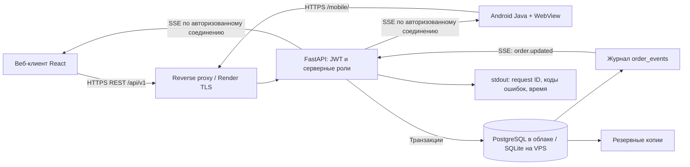

# Архитектура

Оба клиента используют один контракт. Android — тонкий клиент с собственным APK, стартовым экраном настройки HTTPS-сервера и мобильным интерфейсом `/mobile/`. React-компоненты переиспользуются, маршруты входа и метка канала разделены. Это снижает расхождение логики и стоимость сопровождения; проверка прав, цен, остатков и переходов всегда выполняется API. PWA — дополнительный способ установки мобильного интерфейса.

## Хранение и транзакции

- Пользователи, хеши scrypt, сессии, товары, заказы, снимки позиций, события, ключи идемпотентности — в одной БД.
- Деньги — целые копейки, никакой арифметики float. Итог рассчитывается на сервере по актуальным ценам. Доставка курьером 490 ₽, от 15 000 ₽ бесплатно, самовывоз бесплатный; оплата при получении. Реального эквайринга/службы доставки нет: он не нужен для кейса.
- Цена и название позиции копируются в заказ. Последующие изменения каталога не меняют исторический заказ.
- SQLite: WAL, `synchronous=FULL`, foreign keys, busy timeout, `BEGIN IMMEDIATE` — для одного узла и небольшой нагрузки.
- PostgreSQL: пул максимум 5 соединений, таймауты запросов и блокировок, `FOR UPDATE` товаров в порядке product_id, sequence номеров заказов. При отмене товары также обновляются в общем порядке.
- Создание заказа, списание остатков, запись события и idempotency key — одна транзакция. PostgreSQL использует транзакционную advisory-блокировку по пользователю и ключу, SQLite сериализует записывающие транзакции.
- Смена статуса блокирует строку заказа и проверяет `version`; устаревшая версия даёт 409. Товары возвращаются в остаток только при единственном допустимом переходе в `cancelled`.
- Схема v1 создаётся идемпотентно при старте. Будущие изменения схемы требуют явной миграции и предварительного backup; автоматического универсального механизма обновления на неизвестные версии нет.

## Роли и безопасность

| Действие | Гость | Покупатель | Оператор |
|---|---|---|---|
| Каталог | Да | Да | Да |
| Регистрация обычного аккаунта | Да | — | — |
| Оформление заказа | Нет | Да | Да, от своего имени |
| Просмотр своих заказов | Нет | Да | Да |
| Просмотр чужих заказов | Нет | Нет, 404 | Да |
| Смена статуса | Нет, 401 | Нет, 403 | Да |
| Создание оператора через API регистрации | Нет | Нет | Нет, только CLI |

JWT HS256 выдаётся на 15 минут. Refresh token — 48 случайных байт, HttpOnly/Secure/SameSite=Strict cookie на 30 дней. В БД хранится только SHA-256 refresh token. При обновлении refresh token ротируется; стабильный id сессии сохраняет действительность уже выданных JWT в других вкладках. Есть 10-секундное окно предыдущего refresh token для одновременных запросов; Web Locks сериализует обновление между вкладками при поддержке браузером. Logout отзывает всю сессию. Две независимые авторизации создают две независимые сессии. Для двух разных ролей используйте разные браузерные профили.

JWT остаётся в памяти JS, не в localStorage. При перезагрузке клиент получает новый JWT через HttpOnly refresh cookie. Сервер проверяет действующую сессию, затем читает роль из БД, а не доверяет присланной клиентом роли. SSE повторно проверяет сессию; logout/истечение доступа закрывает поток.

Пароли хешируются scrypt с независимой случайной солью; параметризованные SQL защищают значения запросов; Pydantic отвергает лишние поля, в том числе `role` при регистрации. React экранирует текст. Для изменяющих запросов проверяется Origin, cookie имеет SameSite. У production reverse proxy есть лимит тела и CSP. Лимит попыток регистрации/входа хранится в БД и переживает рестарт процесса.

Демовход оператора включается **только** `DEMO_MODE=true`. Это открытый демонстрационный доступ ко всем демозаказам; его обязательно выключать перед реальными пользователями. Это явно отражено в интерфейсе и документации. В production нет предустановленного пароля оператора.

## Синхронизация

1. Оператор передаёт новый статус и текущую `version`.
2. Backend в транзакции проверяет роль/переход/версию, сохраняет заказ и `order_events`.
3. Каждый SSE-поток читает события из БД раз в секунду, только для владельца; оператор получает все.
4. SSE содержит идентификатор события. Клиент обновляет данные через общий REST API; события не являются вторым источником состояния.
5. При обрыве клиент переподключается с `after` последнего события. Потерянные события доступны после рестарта backend, потому что журнал находится в БД.
6. Поток переоткрывается каждые 10 минут. Клиент обновляет истёкший JWT. Дополнительно REST polling каждые 30 секунд помогает при прокси, которые буферизуют SSE.

Курсор не сохраняется между перезапусками клиента: при открытии заново загружаются заказы и повторно читаются доступные события. Это безопасно: события только инициируют чтение, не создают заказы. События хранятся без автоматического удаления в v1; при большом объёме потребуется архивирование с сохранением истории заказов.

## Работа в России

Шрифты, картинки, JS и документация размещены вместе с приложением. Нет Firebase, Google Auth, Stripe, внешних CDN и карт. Валюта RUB, локаль ru-RU, даты показываются в часовом поясе Москвы. Телефоны валидируются в российском формате.

Бесплатный Render + внешняя PostgreSQL — вариант для демонстрации с ограничениями иностранных сетей и тарифов. Для контролируемой доступности и хранения данных в России тот же Docker-образ переносится на российский VPS, без зависимости от Render в клиентском коде.
